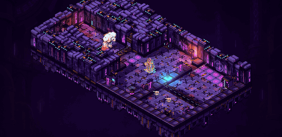
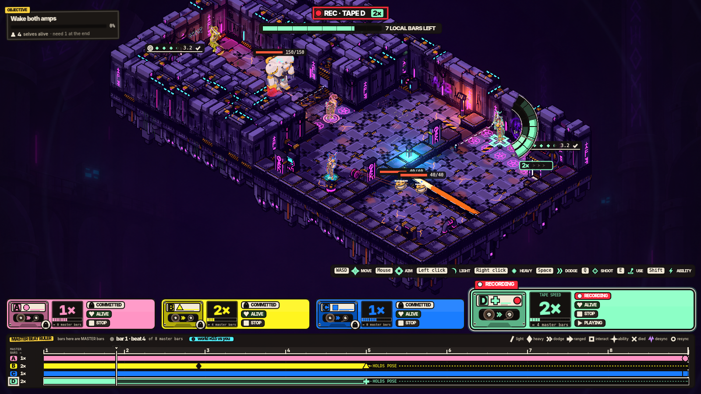
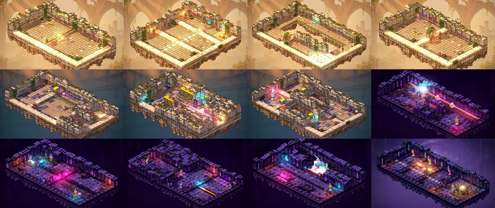
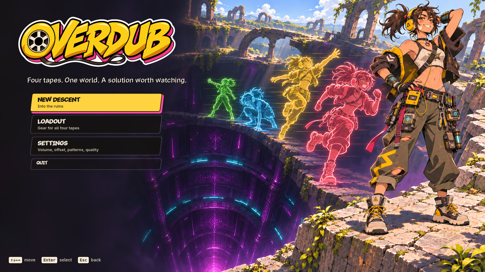
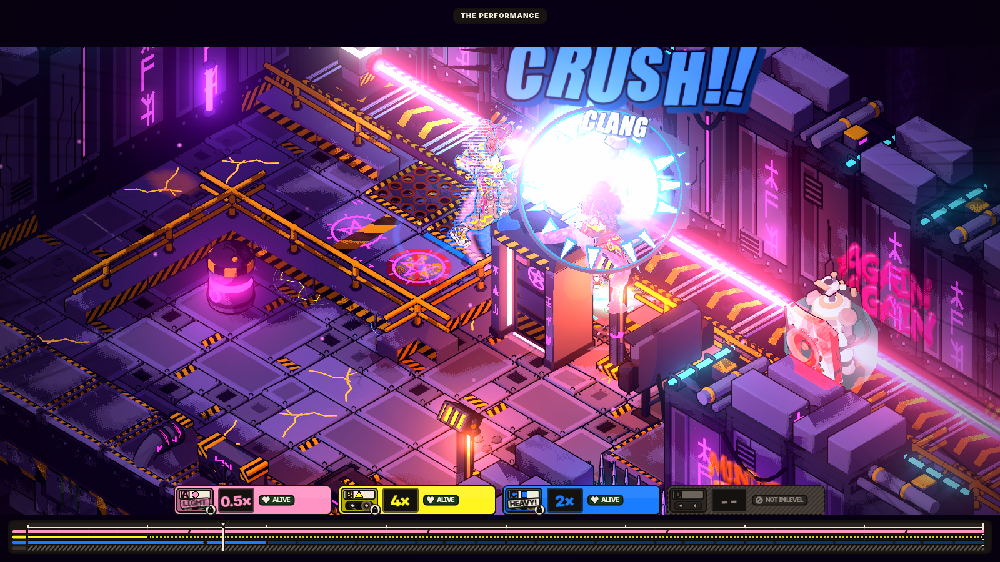
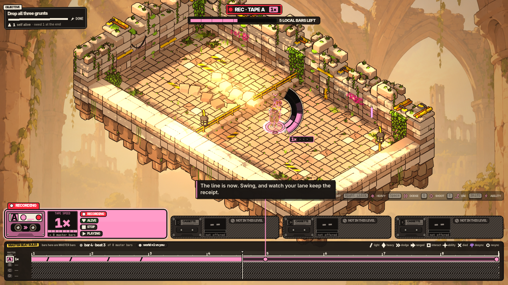
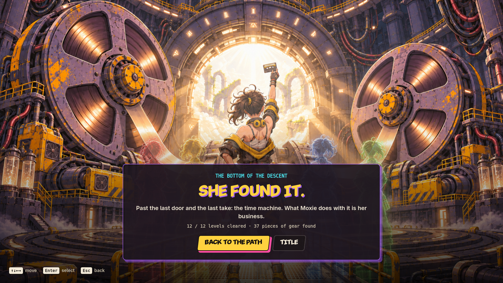

<div align="center">


# OVERDUB

**Four tapes. One world. A solution worth watching.**

An isometric puzzle-brawler where you record up to four takes of yourself onto cassette,
each at its own tape speed, then watch them all play back together and win as a crew of one.

### [▶ Play it in your browser](https://overdub.joeyhersh.com)

[](https://overdub.joeyhersh.com)
[](https://godotengine.org)
[](LICENSE)
[](#under-the-hood)



</div>

---

## The pitch

Moxie goes down into the ruins for the score nobody has pulled. Rumour says there's a time
machine at the bottom, and everyone agrees it takes a crew of four to reach. Moxie doesn't do crews.

What she has is a Walkman with a strange recording head. Press record and everything she does
goes onto tape. Rewind, pick up a fresh cassette, and her last take plays back beside her while
she records the next one. Before long four Moxies are working one room, each running at its own
speed, all locked to the same beat.

You solve a level when the copies of Moxie, together, do what one of her couldn't.

## How a level plays



1. **Set up a cassette.** Choose its **tape speed** (0.5×, 1×, 2× or 4×) and what happens when the
   tape runs out: **stop**, **repeat** or **reverse**. A 2× take moves twice as fast and hits
   twice as hard, but gets half as much time.
2. **Record.** After a count-in, everything you do goes on tape: moving, swinging, dodging,
   shooting, pulling levers. Every earlier take plays back alongside you.
3. **Review and commit.** Keep the take, or rewind and record it again. Takes always restart from
   beat zero, and the room resets with them.
4. **Win as a crew.** When the takes together finish the objective with at least one Moxie still
   standing, the game re-cuts your solution as a **cinematic**, scored and shot on the beat.

A dead take isn't wasted. A Moxie who dies at the right moment still held that door open long
enough for the next one to get through.

## Twelve floors down



| # | Level | |
|---|---|---|
| 01 | **Soft Open** | One grunt. Then two. Press record. |
| 02 | **Hit Harder** | Same swing. Faster tape. |
| 03 | **Hold the Door** | One of you holds it. The other has to still be around when it opens. |
| 04 | **Second Opinion** | It shrugs off one of you. |
| 05 | **Dead Air** | Four jobs. Three cassettes. One of you works a double shift, dead. |
| 06 | **Crossfire** | The stalker wants whoever is farthest. The sentry wants whoever it can see. Introduce them. |
| 07 | **Out of Phase** | Shut a door on yourself. Walk through the fire. Come back for your hands. |
| 08 | **Loop Pedal** | One of you stays. One of you lasts. One of you comes round again. |
| 09 | **Rewind** | What you opened on the way out, you close on the way back. |
| 10 | **Heavy Rotation** | Two machines, four of you. Spend them carefully. |
| 11 | **The Archivist** | It has read every tape you kept. Give it something to read. |
| 12 | **Master Tape** | Every take was holding a door for the next one. |

Every level ships with a stored solution, and the test suite replays all of them, so every
puzzle is proven solvable.

## What's in the box

- **A four-track tape deck as the HUD.** Four cassettes and a master beat ruler show every take's
  speed, end mode, life state and actions against one shared timeline.
- **Music that plays with you.** The soundtrack is generated live by *Harmonograph*, a synthesiser
  and composer built for the game. Each cassette drives its own voice, so a 2× take is literally
  double time.
- **Combat with weight.** Momentum scales with tape speed and approach. Hits land with hitstop,
  impact bursts, afterimages and decals.
- **Six kinds of robot and a boss:** grunts, brutes, shielders, stalkers, sentry turrets and
  drones, then the Archivist.
- **Traps and machines:** spikes, crushers, conveyors, flame jets, dart launchers, bumpers, beam
  sensors, relays and magnets, plus lasers, doors and pressure plates. All of them run on the same
  deterministic clock as you.
- **37 pieces of gear** in six slots, a wardrobe, and loot that changes how your takes play.
- **A voiced story** with Moxie, Opal, Tolliver and the Archivist, illustrated dialogue portraits,
  and a Field Guide that fills in as you meet things.
- **Replays.** Every winning performance is kept and can be watched again from the campaign map.
- **Accessibility options:** colour-blind cassette palettes, cassette patterns, high contrast,
  text size, hold-or-press-twice confirmations, audio/video offset, screen shake and reduced
  flashing.

<table>
<tr>
<td></td>
<td></td>
</tr>
<tr>
<td></td>
<td></td>
</tr>
</table>

## Controls

| Action | Keyboard and mouse | Gamepad |
|---|---|---|
| Move | W A S D or arrows | Left stick |
| Aim | Mouse | Right stick |
| Light attack | Left click | X or RT |
| Heavy attack | Right click | Y or LT |
| Dodge | Space | A |
| Use / interact | E | B |
| Ranged weapon | Q or F | RB |
| Ability | Shift | LB |
| Pause | Esc or P | Start |
| Setup: tape speed down / up | Q / E | LB / RB |
| Setup: cycle end mode | Tab | Y |
| After a take: retry / commit | R / C | X / — |
| End the attempt | Backspace or Delete | B |
| Reset all tapes (hold) | Backspace or Delete | Back + Y |
| Skip the cinematic (hold) | Enter, Space or Esc | A, B or Start |

The source of truth is [`game/input.gd`](game/input.gd).

## Play it

**In the browser:** **[overdub.joeyhersh.com](https://overdub.joeyhersh.com)**. Use a desktop
browser with WebGL 2 (Chrome, Edge or Firefox). The first load downloads about 250 MB.
The browser build uses Godot's Compatibility renderer, so it skips the colour-grading pass that the
desktop build has.

**From source:** install [Godot 4.4.1](https://godotengine.org/download/archive/4.4.1-stable/),
open this folder, and press Play. Or from a terminal:

```sh
godot --path .            # runs res://game/main.tscn
```

## Under the hood

OVERDUB is built so the puzzles can be trusted.

- **Deterministic simulation.** [`core/`](core/) runs at 240 substeps per second, with 60 local
  ticks per second scaled by each tape's speed. It has no nodes, no wall clock, and no randomness.
  A take is a fixed trajectory plus a list of attempted actions, so it replays identically every
  time. That includes desyncs: when the world changes under a recorded take, the game shows a
  recovery spark and the take finds its way back.
- **Two implementations that must agree.** [`prototype/`](prototype/) is an earlier TypeScript
  build kept as the executable rulebook. The Godot core is a port of it, and 163 golden scenarios
  exported from the prototype must come out identical in Godot, tick for tick.
- **Tested end to end.** 1,246 Godot tests and 840 prototype tests cover the simulation, every
  level's stored solution, audio scheduling, UI flow, saves, and a requirement-by-requirement
  acceptance suite ([`docs/ACCEPTANCE.md`](docs/ACCEPTANCE.md)). A windowed bot plays all twelve
  levels through the real game loop and screenshots each step.

```sh
bash tools/gd test                  # every Godot suite (imports first)
bash tools/gd test levels           # all twelve levels replayed from their stored solutions
cd prototype && npx vitest run      # the rules reference
bash tools/gd shot res://tools/smoke.gd -- <dir>   # play a slice of the real game, with screenshots
bash tools/web/publish.sh           # export the web build and publish it
```

`tools/gd` finds `godot4`, `godot` or `godot_console.exe` on your PATH, or set `GODOT=/path/to/godot`.

<details>
<summary><b>Project layout</b></summary>

```
core/            deterministic simulation: no nodes, no clock, no randomness
content/         loaders for data/, loadout resolution, level validation
data/            levels and their solutions, gear, story, music, codex, accessibility data
game/            session state machine, input, save, campaign, web build support, app wiring
world/           level construction from the kit, camera, lighting, decals, music displays
actors/          Moxie, the robots, projectiles, cassette identity
feel/  fx/       hit feel; particles and music-linked effects
cinema/          the director that plans the winning replay's shots
musicviz/        music displays mounted in the world
audio/           Harmonograph synthesiser, music director, quantised effects, voice
replay/          kept winning performances
ui/              HUD, menus, dialogue, coach marks, widgets, theme
assets/          what the game loads: models, textures, audio, portraits, UI art
art/             sources and build scripts for everything in assets/
tests/  tools/   test suites and goldens; dev and web build scripts
docs/            design and module documents
prototype/       the TypeScript reference build
```

Start with [`docs/ARCHITECTURE.md`](docs/ARCHITECTURE.md) for the design and its rules, and
[`docs/GODOT-PORT.md`](docs/GODOT-PORT.md) for layout, conventions and the asset contract.
[`docs/requirements.txt`](docs/requirements.txt) is the original design brief.

</details>

<details>
<summary><b>Rebuilding assets</b></summary>

Everything in `assets/` is produced by a script under `art/`: edit the source and rebuild, never
the output. Blender is 4.5: `blender --background --python art/<script>.py -- <args>`.

| Output | Rebuild with |
|---|---|
| Robots, kit, traps, weapons, headgear | the Blender scripts in `art/enemies/`, `art/kit/`, `art/traps/`, `art/weapons/`, `art/wardrobe/` |
| Moxie (`assets/models/moxie.glb`) | the numbered steps in `art/moxie_e/`; outfit masks with `python tools/moxie_regions.py` |
| Animation library | `art/anim/build.py`, then `assets/anim/library/build_library.gd` |
| Samples | `python -I art/audio/make_samples.py [family ...]` |
| Textures, portraits, UI art, icons | the scripts in `art/world_art/`, `art/portraits/`, `art/ui_art/`, `art/icons/`, reading each `raw/` folder |
| Level music | `python art/music/merge.py` |
| Level index, solutions, goldens | `cd prototype && npx vite-node scripts/level.ts index --write`, `level.ts run NN --write`, `scripts/export-goldens.ts` |

Run `bash tools/gd import` after any rebuild.

</details>

## Licence

OVERDUB's code and original content are released under the **[MIT License](LICENSE)**.

A few assets come from third parties and keep their own terms. The MIT licence does not override
them. [`assets/LICENSES.md`](assets/LICENSES.md) lists every source. The ones to know about:

- **Moxie's 3D mesh** was generated with Tencent Hunyuan3D-2, whose community licence forbids using
  or distributing its output in the EU, the UK and South Korea.
- **Voice lines** were generated with ElevenLabs stock voices, under ElevenLabs' terms.
- **Fonts:** Inter (SIL Open Font License 1.1) and DejaVu Sans Mono (Bitstream Vera licence),
  with their licence texts in [`ui/theme/fonts/`](ui/theme/fonts/).
- **Animation sources** retargeted from Quaternius' Universal Animation Library (CC0).

Built with [Godot](https://godotengine.org) and [Blender](https://www.blender.org).
