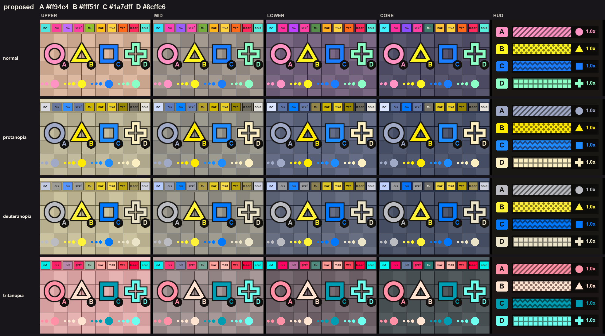
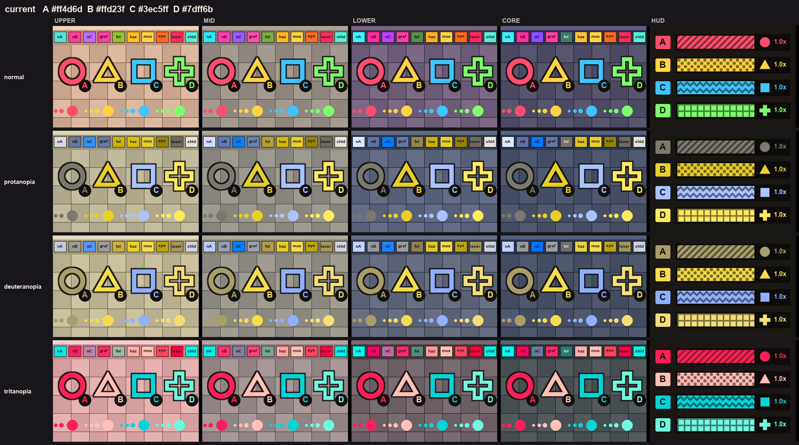
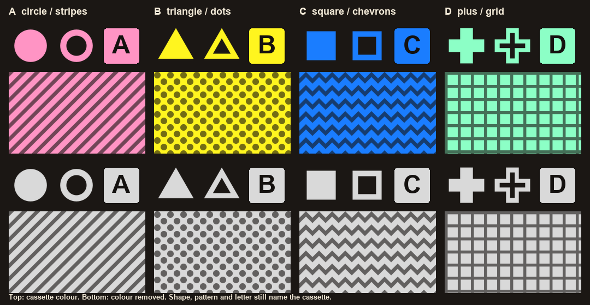

# OVERDUB — readability and accessibility

Covers requirements chapter 16 (UI-02, UI-03, "Useful working interface implications"), chapter 19
("Cassette colors are a functional layer"), NEW-11 (states readable without audio) and chapter 18
(dark lower levels stay readable).

Everything here is a proposal plus data and a helper class. **Nothing in the game calls it yet.**
The integration steps are in section 7; the per-area checklists are in section 8.

| What | Where |
|---|---|
| Cassette colour sets with their measurements | `data/accessibility/palette.json` |
| Letter, shape, pattern per cassette; where each is carried | `data/accessibility/patterns.json` |
| Redundant channels per actor state and deck state | `data/accessibility/state_channels.json` |
| Options, defaults, photosensitivity limits | `data/accessibility/options.json` |
| GDScript access to all of the above | `data/accessibility/access_kit.gd` (`AccessKit`) |
| Pattern tiles and shape masks (128 px) | `assets/textures/patterns/` |
| Analysis scripts, plates, flash checker | `art/accessibility/` |

## 1. Summary of decisions

1. **The current four colours do not work.** Yellow B and green D are the same colour to a
   red-green colour-blind player (CIEDE2000 5.0), B is exactly Moxie's gold, and red A is 4 away
   from the laser and the enemy hit colour.
2. **Proposed set: Rose `#ff94c4`, Lemon `#fff51f`, Azure `#1a7dff`, Mint `#8cffc6`.** Yellow and
   blue keep their identity. Red becomes rose and green becomes mint; both changes are forced (2.3).
3. **High-contrast alternative: `#ffb3e0`, `#f6fa00`, `#0a55c8`, `#189e95`**, which also separates
   the four by lightness. It is an option, not the default, because its blue and teal are too dark
   to use as text on the HUD panel without a lifted tone.
4. **Colour is never the only carrier.** Each cassette has a letter (A–D), a shape (circle,
   triangle, square, plus) and a pattern (stripes, dots, chevrons, grid). Letter and shape are
   always on. Patterns are an option, default off.
5. **Every cassette mark in the world carries an ink keyline.** No bright colour reaches 3:1
   against the upper and mid floors (worst case 1.07:1), so this is a rule and not a setting.
6. **No colour-only states.** Section 4 gives the channels for seven actor states and eleven deck
   states. The HUD already meets most of it; the actors do not (section 5).
7. **Options:** cassette patterns, cassette colours (standard / high contrast), high-contrast
   outlines, reduce flashing, screen shake (off / reduced / full), hold actions (hold / press),
   text size, audio / visual offset. No slow-recording assist: tape speed is the mechanic.
8. **Photosensitivity limits** are stricter than WCAG 2.3.1: at most 2 large-area flashes per
   second by default, none with reduce flashing on, never a large saturated-red flash.

## 2. Cassette colours

### 2.1 Method

- Distance: CIEDE2000 between sRGB colours. Under 10 is confusable at a glance, 10–20 is separable
  side by side, 20 and above is comfortable.
- Colour-vision simulation: Machado, Oliveira & Fernandes 2009 at severity 1.0 (full dichromacy),
  applied in linear RGB. Anomalous trichromats (the majority) see something between the normal row
  and the simulated row.
- Contrast: WCAG relative-luminance ratio.
- Theme colours are parsed from `world/world_palette.gd` at run time, so re-running the analysis
  follows the real palettes. HUD colours come from `ui/theme/palette.gd`; reserved colours from
  `actors/enemy_specs.gd`, `fx/fx_colors.gd`, `world/world_mech_accent.gd`, `actors/actor_style.gd`
  (listed in `art/accessibility/refs.py`).
- Re-run: `python -I art/accessibility/analyze.py`, then `build_data.py`, then `make_plates.py`.
  Full tables for every set are in `art/accessibility/out/analysis.md`.

### 2.2 What is wrong with the current set

Current: A `#ff4d6d`, B `#ffd23f`, C `#3ec5ff`, D `#7dff6b`.

| Problem | Number |
|---|---|
| B and D under deuteranopia | dE 5.0 (protanopia 6.4): the same yellow |
| C and D under tritanopia | dE 12.3 |
| A and D under deuteranopia | dE 19.2; A and B 21.1 |
| B against Moxie's gold `#ffd23f` | dE 0.0: the same colour |
| B against hazard yellow (upper / core / mid) | dE 5.1 / 5.6 / 8.4 |
| A against enemy hit `#ff3d5a`, laser `#ff2b5e`, closed door, REC lamp | dE 3.9 / 4.0 / 7.6 / 9.9 |
| A against the mid floor under protanopia | dE 5.3: the red ring sinks into the floor |
| A against upper neon B / graffiti pink | dE 12 / 14 |
| C against mid neon A `#2fe6ff` | dE 13 |
| Any colour against the upper floor | contrast 1.08–1.76:1 |

`ui/theme/palette.gd` also reuses cassette colours for meaning: `THREAT` and `STATE_BAD` equal A,
`STATE_GOOD` equals D. An "ALIVE" badge is therefore drawn in cassette D's colour on every deck.

### 2.3 Proposed set

| | A Rose | B Lemon | C Azure | D Mint |
|---|---|---|---|---|
| Colour | `#ff94c4` | `#fff51f` | `#1a7dff` | `#8cffc6` |
| Deep (shell shading) | `#b26286` | `#b2ab09` | `#0550b2` | `#5cb287` |
| Night (lane background) | `#382a30` | `#38371a` | `#192638` | `#283830` |
| Text drawn on it | ink | ink | ink | ink |
| Contrast with ink | 9.21 | 16.42 | 4.85 | 15.43 |
| Contrast on HUD panel | 8.72 | 15.55 | 4.60 | 14.61 |

Why red and green had to move:

- **Red cannot stay red.** Saturated red is the danger colour (laser, enemy hit, closed door, REC
  lamp, enemy warning), and under protanopia and deuteranopia every saturated red collapses to a
  dark olive that matches the mid floor. A coral `#ff7a66` was tested (`coral_variant` in
  `sets.json`): it keeps a red reading but sits 10.2 from the enemy warning colour and 12.3 from the
  enemy hit colour. Rose is 21.8 or more from every danger colour and stays light under every
  simulation.
- **Green cannot stay yellow-green.** Any green with a yellow component lands on yellow under
  red-green deficiency. Mint keeps "the green one" for normal vision and goes near-white, not
  yellow, under protanopia and deuteranopia.
- **Yellow moves from gold to lemon** to get away from Moxie's gold and from hazard yellow. This
  resolves the signature-colour conflict only partly: lemon is 11.4 from her gold in normal vision
  and 6 under dichromacy. Her gold stays on her headphones, Walkman and brand UI; cassette B always
  wears its triangle and letter. Nothing bright and yellow can be fully separated from gold.
- **Blue becomes deeper** so it stops matching the cyan neon (mid neon A was 13 away; now 37) and
  separates from mint under tritanopia.

### 2.4 Before and after

Lowest pairwise distance between any two cassettes (the pair in brackets):

| Vision | Current | Proposed | High contrast |
|---|---|---|---|
| Normal | 31.0 (B–D) | 29.9 (B–D) | 40.3 (C–D) |
| Protanopia | **6.4** (B–D) | 19.0 (B–D) | 18.1 (A–D) |
| Deuteranopia | **5.0** (B–D) | 16.5 (A–D) | 20.2 (A–D) |
| Tritanopia | **12.3** (C–D) | 25.7 (A–B) | 20.2 (C–D) |

Distance to things a cassette must not be mistaken for (normal vision):

| | Current | Proposed | High contrast |
|---|---|---|---|
| Nearest reserved colour | 0.0 (B = Moxie gold) | 11.4 (B–Moxie gold, D–shield teal) | 14.1 (B–Moxie gold) |
| Nearest danger colour | 3.9 (A–enemy hit) | 21.8 (A–laser) | above 22 |
| Nearest hazard yellow | 5.1 (B) | 16.2 (B) | 19.0 (B) |
| Nearest theme accent | 5.1 (B–upper hazard) | 12.4 (A–mid graffiti) | 13.7 (D–core foliage) |
| Lowest contrast on HUD panel | 5.54 (A) | 4.60 (C) | 2.67 (C), 5.40 (D) |
| Lowest contrast on any floor | 1.08 | 1.07 | 1.06 |

What the proposed set gives up: the normal-vision minimum drops from 31.0 to 29.9 (B–D, lemon
against mint). That pair is the price of pulling green away from yellow under red-green deficiency.

### 2.5 Weak points that remain

These are measured, and none of them has a colour-only fix. Shape, letter and keyline cover them.

- **Bare contrast against floors is about 1.1:1 for some colour on every theme.** Azure on the mid
  floor is 1.07:1; lemon and mint on the upper floor are 1.2–1.6:1. The ink keyline is mandatory.
- **Mint on the upper floor under deuteranopia is dE 8.3**; rose on the upper floor under
  tritanopia is 10.3. Again the keyline carries it.
- **Rose under protanopia is 3.9 from the HUD dead-grey `#9aa3b5`.** High-contrast teal under
  deuteranopia is 2.6 from the ghost outline grey `#7d8394`. A search over neutral and tinted greys
  found none further than 11.6 from all eight cassette colours in all four visions, so grey cannot
  be made safe. "Dead" must be read from the hollow body, the ghost icon and the word.
- **High-contrast azure and teal are dark.** Azure is 2.67:1 on the HUD panel. Text in a cassette
  colour must use `text_on_panel` (`#4780d6` for azure) and text on an azure fill must be paper,
  not ink. `palette.json` carries both per set.
- **The search did not meet every target.** Its targets were 35 pairwise in normal vision, 18 under
  protanopia / deuteranopia, 14 under tritanopia. The proposed set reaches 0.69 of target at its
  weakest point (mint on the upper floor) and 0.85–0.92 on the pairwise targets. No set that keeps
  four bright, distinct hues met all of them; `out/search.json` has the candidates.

### 2.6 Plates

All plates were rendered by `art/accessibility/make_plates.py` and inspected.

- `art/accessibility/plates/plate_swatches.png` — the four sets and the reserved colours, normal and
  simulated. Shows current B and D turning the same yellow in rows 2 and 3.
- `art/accessibility/plates/plate_themes_current.png`, `plate_themes_proposed.png`,
  `plate_themes_high_contrast.png` — ring, letter badge, spark trail and theme accents on each of
  the four theme floors, plus HUD lanes, under each vision.
- `art/accessibility/plates/plate_identity.png` — letter, shape and pattern with colour removed.







What the plates show that the numbers do not: with the keyline, all four shapes read on every floor
in every simulation, including where the fill colour nearly matches the floor (current A on mid
under protanopia; high-contrast D on mid under deuteranopia).

## 3. Non-colour identity

| Cassette | Letter | Shape | Pattern | Pattern texture |
|---|---|---|---|---|
| A | A | circle | stripes (45° bars) | `pattern_a_stripes.png` |
| B | B | triangle | dots (staggered) | `pattern_b_dots.png` |
| C | C | square | chevrons (zigzag rows) | `pattern_c_chevrons.png` |
| D | D | plus | grid (0° / 90° lattice) | `pattern_d_grid.png` |

The shapes differ in corner count (0, 3, 4, 12) and stay distinct at 10 px. The grid is 0° / 90°
on purpose: a diagonal cross-hatch reads as the same texture as diagonal stripes at lane height.

**Textures** (`assets/textures/patterns/`, generated by `art/accessibility/make_patterns.py`):

- Four 128 px greyscale coverage tiles, white = pattern. Each repeats 4 times per tile (32 px
  period) and covers 40 % of its area, so a pattern does not change how light a colour looks.
- `pattern_strip_abcd.png`: the four tiles side by side for a `Texture2DArray`.
- `shape_<letter>_<shape>.png` and `..._ring.png`: white RGBA masks, 128 px.
- Seamlessness: each tile is an analytic periodic function at 8× supersampling. `make_patterns.py`
  renders a 2 × 2 field directly and compares it with the tiled tile (maximum difference 0 for all
  four, `out/pattern_check.json`). `check_data.gd` repeats the wrap test on the imported textures
  in Godot.
- Import note: the `.import` files use the project defaults. Whoever draws them in 3D must enable
  repeat on the sampler (`repeat_enable` in the shader uniform hint); `AccessKit.draw_pattern`
  tiles in 2D without needing it.

**How each mark carries identity** (machine-readable in `patterns.json` → `carriers`):

| Mark | Letter | Shape | Pattern | Specification |
|---|---|---|---|---|
| Outline (ink hull) | – | – | – | Cassette colour only. Never the sole identity: the ring under the figure names it. |
| Floor ring | always | always | option | Ring outline is the cassette shape (`AccessKit.ring_mesh`, 0.45 m circumradius, 0.07 m band) over an ink backing ring. Letter badge on the camera side at 0.6 opacity or more. Pattern fills the faint inner disc, 2 tiles per metre, fixed in world space. |
| Spark | – | always | – | Core is the filled cassette shape, 0.16 m, billboarded, white centre, ink keyline. Comet trail is shrinking copies of the shape. |
| Tether | – | – | – | Dashed cassette colour over an ink under-stroke 2 px wider. |
| Swing trail | – | – | option | Cassette colour ribbon; pattern runs along it (one tile per 0.5 m) at 0.35 alpha, not scrolling. |
| Self's projectile | – | always | – | Small filled cassette shape at the head, ink keyline. Enemy shots never use the four shapes. |
| Enemy target pip | always | always | – | Cassette shape with the letter, not a coloured dot. |
| HUD deck | always | always | option | Letter sticker; shape mark beside the speed readout; pattern over the shell at 48 px per tile. |
| HUD lane | always | always | option | Letter chip; lane end cap is the shape (filled when recorded, ring when not); pattern on every recorded pass. |
| Map pip | 14 px and up | always | – | Filled shape with ink keyline. |
| Off-screen marker | always | always | – | Edge arrow ending in the shape with the letter. |

Keylines (`palette.json` → `keylines`): 2 px ink at 1080p by default. In high-contrast mode, 3 px
ink with a 2 px paper line between colour and ink. Widths scale with viewport height and never drop
below 1.5 px. `AccessKit.keyline_px(viewport_h, high_contrast)` returns both.

## 4. State readability

The full tables are in `data/accessibility/state_channels.json`. The rule every pair must pass:

> Two states in a `must_differ` list differ on at least two channels other than colour and audio,
> and at least one of those does not depend on motion. A paused frame, a screenshot and the
> reduce-flashing option must all still read.

### 4.1 Actor states

| State | Body | Outline | Floor ring | Marker | Motion | HUD word |
|---|---|---|---|---|---|---|
| Alive | opaque cel-shaded | continuous, cassette colour | solid, full | none (recorded self: bouncing chevron, pulsing outer ring) | animates | ALIVE |
| Recording ghost | hologram ~0.55 with scanlines | continuous, 1.25× | **dotted** | broken halo | halo wobble, rising bits | DIED — RECORDING AS GHOST |
| Playback ghost | **hollow**, rim only | thin, grey | **thin** single line, ≥ 0.35 opacity; badge ≥ 0.6 | none | replays; dust; no impacts | DEAD — GHOST |
| Desynced projection | translucent ~0.42, sliced bands, split echo | **dashed** | **dashed, doubled** | tether to spark; broken-link glyph | irregular flicker (reduced: steady, bands drift) | DESYNCED — SPARK CHASING |
| Recovery spark | cassette-shape core, white centre | ink keyline | none | tether; shape comet trail | travels the path; one pulse per beat | SPARK CHASING, then RESYNCED |
| I-frames | 0.3 / 0.85 translucent, no bands | continuous, **paper white** | solid (unchanged) | three afterimages | one dodge long; flicker (reduced: steady 0.6) | none (dodge glyph on the lane) |
| Stopped | opaque, held pose, desaturated | continuous, greyed | solid | **pause glyph** | frozen | STOPPED — HOLDING POSE |

Combinations: recording ghost + desynced keeps halo and dotted ring and adds tether, broken link and
echo. Playback ghost + desynced keeps the hollow body, adds the tether and dashes the thin ring.
A stopped ghost is the hollow body plus the pause glyph.

Ring line styles are the motion-free channel for life state: solid (alive, i-frames, stopped),
dotted (recording ghost), thin (playback ghost), dashed double (desynced). `AccessKit.ring_mesh`
gives UV.x running 0–1 around the perimeter so one shader can cut all four.

### 4.2 Deck states

| State | Word | Icon | Cassette / shell | Lane | Motion |
|---|---|---|---|---|---|
| Unavailable | NOT IN THIS LEVEL | none | full hatch, no reels | hatched | none |
| Unrecorded | NOT RECORDED | empty | dashed outline, hubs only | empty between dashed lines | none |
| Armed | ARMED | arm | halo, paper frame, GET READY tab | dashed span preview | halo pulses on the beat |
| Recording | RECORDING | rec | RECORDING tab with lamp | solid fill growing to playhead | lamp ~1.1 Hz (reduced: steady); reels turn |
| Pending | TAKE — NOT COMMITTED | take | diagonal stripes on the label | striped fill | follows transport |
| Committed | COMMITTED | lock | lock sticker | plain solid fill | follows transport |
| Stopped | STOPPED — HOLDING POSE | hold | pause bars between reels | dashed hold line from a square end mark, "HOLDS POSE" | reels still |
| Looping | LOOPING · PASS n | repeat | forward chevrons | ink cut at each pass, forward arrows | reels forward |
| Reversing | REVERSING · PASS n | rewind | backward chevrons | turn notch, backward arrows | reels backward |
| Dead | DEAD — GHOST | ghost | greyed shell, grey tape pack, letter keeps colour | death glyph, hollow stretch after it | follows transport |
| Desynced | DESYNCED — SPARK CHASING | desync | desync sticker, offset bars | desync glyph, dashed stretch to resync glyph | bars jitter (reduced: static offset) |

A deck too small for every badge row still shows, without colour: the status icon, the life icon
when not alive, and the transport as reel direction plus chevrons or pause bars.

## 5. Review of the current implementation

Reviewed: `ui/hud/*.gd`, `ui/theme/palette.gd`, `ui/menus/art/menu_art.gd`, `actors/actor_style.gd`,
`actors/self_view.gd`, `actors/actor_layer.gd`, `actors/enemy_view.gd`, `actors/projectile_view.gd`,
`fx/fx_director.gd`, `world/world_view.gd`, `core/types/save_settings.gd`. Read from source; not
checked against screenshots of the running game.

### 5.1 What already meets the table

- HUD: every deck state has a word and an icon (`hud_model.gd` 387–463), the pending badge is
  hatched, narrow badges fall back to the icon and never to colour alone (`hud_draw.gd` 206–212),
  unrecorded lanes are dashed, unavailable lanes hatched, hold lines dashed with a square end mark
  and "HOLDS POSE", pass arrows show direction, stickers are icon-shaped.
- Actors: six life × sync styles with distinct bodies (solid / hologram / hollow / phased), broken
  halo for the recording ghost, dashed tether, pause glyph for stopped, afterimages for the dodge,
  letter badge on the floor ring, bouncing chevron on the recorded self.
- Screen flashes peak at 0.22 × 1.1 = 0.24 alpha (`fx_director.gd` 982, 990), under the 0.25 limit.

### 5.2 Gaps — actors

| # | Where | Gap | Fix |
|---|---|---|---|
| A1 | `actor_layer.gd` 94–95 | One circular ring mesh is shared by all four tapes. Shape is not carried in the world at all. | Build `AccessKit.ring_mesh(tape, 0.45, 0.07)` per tape (and a wider one for the ink backing). |
| A2 | `self_view.gd` 703–706, `actor_style.gd` table | Life state on the ring is opacity only. Playback ghost ring is 0.95 × 0.18 × 0.75 = 0.13; desynced 0.25. Both are below the 0.35 floor, and no ring is dotted, thin or dashed. | Add a ring line style per style (solid / dotted / thin / dashed double) cut in the flat shader from UV.x; clamp ring opacity to 0.35. |
| A3 | `self_view.gd` 712, 720 | Letter badge fades to 0.4. On a ghost the letter is the only identity left. | Floor at 0.6. |
| A4 | `actor_style.gd` 41 (`Marker`) | No broken-link glyph for the desynced projection. Without the spark in view, desync is carried by flicker and translucency only. | Add `Marker.BROKEN_LINK`, drawn above the head like the pause glyph. |
| A5 | `actor_style.gd` 171–176 (`hull_color`) | Outline keeps the cassette colour during i-frames. I-frames and desync are then both "translucent and flickering". | Paper-white hull while `dodging`; dashed hull for the phased body. |
| A6 | `actor_math.gd` 81–86, `actor_style.gd` 150 | Flicker is a hard three-level stutter with components up to 61.3 rad/s (9.8 Hz); the i-frame flicker runs at 1.6× (9.4 Hz base, with a minor component at 15.6 Hz, over the 10 Hz limit). There is no reduce-flashing input (`SelfView.Env`, `self_view.gd` 52). Four desynced selves near the camera can exceed 2.8 % of the screen. | Add `reduce_flashing` to `Env`; when set, `flick = 1` and the i-frame opacity is a steady 0.6. Drop the 1.6× on the i-frame flicker so every component stays under 10 Hz. |
| A7 | `self_view.gd` 421–436, 784–797 | The spark is a round glow, a round core and a round trail in an additive overlay material: no shape, no keyline. On the upper floor an additive lemon or mint spark is close to invisible. | Core and trail use `AccessKit.shape_texture(tape)`; draw an ink copy 1.25× behind the core in a mix material. |
| A8 | `self_view.gd` 436–437 | Tether has no ink under-stroke. | Second strip in ink, 2 px wider, same dash. |
| A9 | `self_view.gd` 406, 411–413 | Halo is additive and the pause bars are the bare cassette colour; both lack ink backing, so they wash out on warm floors (lemon on the upper wall top is 1.24:1). | Ink-backed copies, as the chevron already has (`_chev_ink`). |
| A10 | `enemy_view.gd` 591 and the target pip | The self an enemy targets is shown by cassette colour alone. | Pip in the cassette shape with the letter. |
| A11 | `projectile_view.gd` 191–211 | A self's shot differs from another self's shot by colour only. Enemy and self shots do differ by archetype model. | Cassette shape mark at the head of a self's shot. |
| A12 | `self_view.gd` disc, `swing_trail.gd` | The `patterns` setting has no effect in the world. | Pattern on the inner disc and along the trail when the option is on. |
| A13 | `enemy_view.gd` 375, 443 | Enemy hit flash is a 0.85 white body flash for 0.14 s; the boss form change flashes for 0.35 s. The boss is large enough to count as a large area. | With reduce flashing: white outline for 0.12 s instead of a body flash. |

### 5.3 Gaps — HUD and menus

| # | Where | Gap | Fix |
|---|---|---|---|
| H1 | `hud_draw.gd` 281–316, `menu_art.gd` 318–345 | Three different pattern sets exist. HUD: stripes, dots, horizontal bars, diagonal cross-hatch. Menus: stripes, dots, zigzag, one solid bar. The diagonal cross-hatch of HUD D is hard to tell from the diagonal stripes of A at lane height. | Both call `AccessKit.draw_pattern(ci, rect, tape, color, tile_px)`; `HudDraw.pattern_name` returns `AccessKit.pattern_id`. Update the settings help text ("stripe / dot / zigzag"). |
| H2 | `hud_ruler.gd` 334 | Lane pattern is drawn on the first pass only (`patterns and first`). Later passes of a looping tape lose it. | Draw on every recorded pass. |
| H3 | `hud_ruler.gd`, `hud_deck.gd` | No cassette shape anywhere in the HUD. The link between "the triangle ring in the world" and "deck B" exists only through the letter. | Shape mark on the deck beside the speed readout and as the lane end cap (`AccessKit.draw_shape`). |
| H4 | `ui/theme/palette.gd` 39–44 | `STATE_GOOD` = cassette D, `STATE_BAD` = `THREAT` = cassette A (47 uses under `ui/`). | Use `palette.json` → `ui_state_colors`: danger `#ff5a3c`, good = paper, warn `#ffb347`. |
| H5 | `hud_deck.gd` 208, 328, 368; `hud_draw.gd` 46 | Text may shrink to 7 px (deck name, captions) and `fit_size` defaults to 6. | Floor of 11 px at 1080p; drop the optional row instead of shrinking further. |
| H6 | `hud_deck.gd` 377, `hud_draw.gd` 226–228 | REC lamp blinks at 1.1 Hz with no steady mode. Small area, so within limits, but it is the only "recording" motion cue and should hold steady under reduce flashing. | `lamp_on = true` when reduce flashing is set. |
| H7 | `hud_deck.gd` 283–288 | Desync glitch slices jitter with no static mode. | Fixed offsets under reduce flashing. |
| H8 | `hud_decision.gd` 142–166 | RESET ALL TAPES is hold-only. | Press-then-press alternative (`holdMode`, section 6). |
| H9 | `ui/theme/palette.gd` 16–21 | `TAPE`, `TAPE_DEEP`, `TAPE_NIGHT` are constants, and letter stickers always use ink text. High-contrast azure needs paper text. | Read from `AccessKit.colors / deep / night / on_color(set_id)`. |

### 5.4 Gaps — effects, world, settings

| # | Where | Gap | Fix |
|---|---|---|---|
| F1 | `fx_director.gd` 990–994 | Full-screen flashes merge by maximum but have no rate limit. Decay is `exp(-3.5 t)`, so a flash has fallen to a quarter after 0.4 s and a second event then reads as a new flash. Three flash events inside one second break the limit; nothing prevents that. | Refuse a new flash within 0.5 s of the last one unless it is stronger by 0.1; clamp through `AccessKit.clamp_flash_alpha`. |
| F2 | `fx_director.gd` 997–1003 | Glitch tear and chromatic split have no reduced mode. | Scale by `flash_limits(reduced).chromatic_split_max`. |
| F3 | `world_view.gd` 192–194 | Shake is on or off. | Multiply by a 0 / 0.4 / 1 scale. |
| F4 | `core/types/save_settings.gd` | Fields exist for `patterns`, `screen_shake`, `av_offset_ms` only. | Add `cassette_palette`, `high_contrast`, `reduce_flashing`, `hold_mode`, `text_scale`, `shake_scale` (section 6). |
| F5 | `core/types.gd` 107–108, `tests/test_skeleton.gd` 59 | `OD.TAPE_COLORS` holds the old set and a test asserts it. | See section 7, step 1. |

Not reviewed: `musicviz/`, `world/` neon pulse amplitudes, cinematic chord-change flashes, the menu
views beyond the cassette art. The limits in section 6.2 apply to them; nobody has measured them.

## 6. Options and limits

### 6.1 Options

Always on, with no switch: cassette letter, cassette shape, ink keyline, a word and an icon for
every deck state, the visual count-in.

| Key | Label | Type | Default | Exists in `SaveSettings` |
|---|---|---|---|---|
| `patterns` | Cassette patterns | on / off | off | yes |
| `cassettePalette` | Cassette colours | standard / high contrast | standard | no |
| `highContrast` | High-contrast outlines | on / off | off | no |
| `reduceFlashing` | Reduce flashing | on / off | off | no |
| `screenShake` | Screen shake | off / reduced (0.4) / full | full | yes, as a bool |
| `holdMode` | Hold actions | hold / press | hold | no |
| `textScale` | Text size | 1.0 / 1.15 / 1.3 / 1.5 | 1.0 | no |
| `avOffsetMs` | Audio / visual offset | −200 … 300 ms, step 5 | 0 | yes |

What each one changes, and which area owns it, is spelled out in `options.json` → `options[].changes`.
Points worth stating here:

- **Patterns default off** because letter and shape already carry identity without colour. The
  first-run screen offers it.
- **Reduce flashing** removes flicker but not information: the dashed outline, the tether and the
  afterimages carry desync and i-frames when the flicker is gone. This is why section 4 requires
  one motion-free channel per pair.
- **Screen shake** migrates from the saved bool: true → full, false → off.
- **Hold actions**: with `press`, the first press arms the action for 3 s and shows "PRESS AGAIN TO
  CONFIRM"; the second confirms; anything else cancels. No gameplay action may require a sustained
  hold without this.
- **Audio / visual offset** shifts beat-synced visuals only. It never shifts the simulation or
  recorded input timing.
- **First run**: offer cassette colours, patterns, reduce flashing and screen shake before the
  first level, with the photosensitivity notice.

Not offered, deliberately:

- **Slow-recording or slow-motion assist.** Tape speed is the mechanic. A slower take is a visible
  choice with a cost on the master timeline; a hidden slowdown would break shared-world timing.
- **Free per-cassette colour picking.** Any pair a player picks has to be re-checked against four
  themes and the danger colours. Two measured sets plus letters, shapes and patterns cover the need.

### 6.2 Photosensitivity limits

These apply to the final picture, so the effect director has to budget them across everything on
screen. Definitions: a *flash* is a pair of opposing luminance changes of 0.10 or more where the
darker state is below 0.80. A *large area* is more than 2.8 % of the screen in total (25 % of a 10°
field). *Saturated red* is R / (R + G + B) ≥ 0.8. WCAG 2.3.1 allows 3 large-area flashes per second.

| Limit | Default | Reduce flashing |
|---|---|---|
| Large-area flashes in any second | 2 | 0 |
| Gap between full-screen flashes | 0.5 s | – |
| Full-screen flash alpha | 0.25 | 0.06 |
| Full-screen fade time, at least | 0.2 s | 0.4 s |
| Full-screen luminance step | – | 0.08 |
| Large-area saturated-red flashes | 0 | 0 |
| Small-area flicker | 10 Hz | none |
| Small flickering area, each / total | 1 % / 2.8 % of screen | – |
| Neon pulse brightness change | 0.10 luminance per beat, smooth ramp | 15 % |
| Chromatic split | 1.0 | 0.25 |
| Screen shake travel / length | 4.5 % of view / 0.6 s | per shake option |

In every mode: never flash a large area in saturated red; never alternate two high-contrast
full-screen frames; patterns never flicker, counter-scroll or cover more than 10 % of the screen;
four selves landing hits on consecutive beats must not add up to a strobe.

**Checking a capture:** `python -I art/accessibility/flash_check.py <frames_dir> --fps 60 --limits
default|reduced` reads PNG frames in name order, reduces each to a 32 × 18 grid and counts general
and red flashes per second per cell. `--self-test` runs it on synthetic sequences. It has been run
on its self-test only; no capture of the game has been checked yet.

## 7. Integration

`AccessKit` (`data/accessibility/access_kit.gd`) is static and has no side effects. It does not
read settings; callers pass the set id and flags.

```
AccessKit.colors(set_id) / deep / night / on_color / text_on_panel   -> Array[Color] of 4
AccessKit.color_names(set_id)                                        -> Array[String]
AccessKit.letter(tape) / shape_id(tape) / pattern_id(tape)
AccessKit.shape_polygon(tape)                 unit outline, x right, y down
AccessKit.shape_texture(tape, ring) / pattern_texture(tape)
AccessKit.draw_shape(ci, tape, center, radius, fill, ink, ink_w, paper_w)
AccessKit.draw_pattern(ci, rect, tape, color, tile_px)
AccessKit.ring_mesh(tape, radius, width)      flat XZ ring, UV.x 0..1 around the perimeter
AccessKit.keyline_px(viewport_h, high_contrast)   -> Vector2(ink, paper)
AccessKit.flash_limits(reduced) / clamp_flash_alpha(alpha, reduced) / option_defaults()
```

Set ids: `AccessKit.SET_DEFAULT`, `SET_HIGH_CONTRAST`, `SET_LEGACY` (the current colours, kept as
the analysis baseline).

Steps, in dependency order:

1. **Core** — `core/types.gd`: set `TAPE_COLORS` / `TAPE_COLORS_RGB` to the default set
   (`#ff94c4`, `#fff51f`, `#1a7dff`, `#8cffc6`), or make `OD.tape_color(tape)` return
   `AccessKit.colors(active_set)[tape]` with a static `active_set`. Update
   `tests/test_skeleton.gd` line 59, and the "legacy set equals OD.TAPE_COLORS" line in
   `art/accessibility/check_data.gd`, which is written against the old values and will fail after
   this change.
2. **Settings** — `core/types/save_settings.gd`: add the six fields from finding F4 with the
   prototype-spelling keys in `KEY_TO_FIELD`; migrate `screenShake`.
3. **UI theme** — `ui/theme/palette.gd`: `tape()`, `tape_deep()`, `tape_night()` read from
   `AccessKit`; add `tape_on()` and `tape_text()`; replace `STATE_GOOD`, `STATE_BAD`, `THREAT`.
4. **HUD and menus** — findings H1–H9. Menu settings screen gains the five new rows.
5. **Actors** — findings A1–A13; `SelfView.Env` and the enemy `Env` gain `reduce_flashing`,
   `high_contrast`, `patterns`.
6. **Effects and world** — findings F1–F3.
7. **Game** — pass the settings to the HUD, the actor layer, the effect director and the world
   view; first-run options screen.

## 8. Checklists

### Actors
- [ ] Floor ring outline is the cassette shape; ink backing ring under it.
- [ ] Ring line style follows life state: solid / dotted / thin / dashed double.
- [ ] Ring never below 0.35 opacity, letter badge never below 0.6.
- [ ] Desynced: dashed outline, tether, broken-link glyph. Reads with flicker off.
- [ ] I-frames: paper-white outline and afterimages. Reads with flicker off.
- [ ] Stopped: pause glyph with ink backing, frozen pose.
- [ ] Spark and its trail are the cassette shape with an ink keyline.
- [ ] Halo, pause bars, tether, chevron all have ink backing.
- [ ] Enemy target pip and a self's projectile carry the cassette shape.
- [ ] Nothing a self owns uses saturated red or Moxie gold as an identity colour.
- [ ] `reduce_flashing` removes all flicker; `high_contrast` widens hulls 1.5× and adds the paper line.
- [ ] `patterns` fills the ring disc and the swing trail.

### HUD and menus
- [ ] One pattern set everywhere, from `AccessKit`.
- [ ] Cassette shape on each deck and as each lane's end cap; pattern on every pass.
- [ ] Every deck state passes `deck_must_differ` in greyscale (screenshot, desaturate, check).
- [ ] No HUD state colour equals a cassette colour.
- [ ] Text on a cassette fill uses `on_color`; cassette-coloured text on the panel uses `text_on_panel`.
- [ ] No text under 11 px at 1080p at scale 1.0; text size option honoured.
- [ ] REC lamp and desync jitter hold still under reduce flashing.
- [ ] Hold-to-confirm accepts press-then-press.
- [ ] Settings rows for every option in `options.json`; first-run screen.

### Effects
- [ ] Full-screen flash alpha clamped through `AccessKit.clamp_flash_alpha`.
- [ ] Rate limiter: at most 2 large-area flashes per second, 0.5 s apart; 0 under reduce flashing.
- [ ] No large-area saturated red, ever.
- [ ] Impact frames keep the ink splash and drop the white ring under reduce flashing.
- [ ] Chromatic split and glitch tear scaled by the mode's limit.
- [ ] A capture of the busiest fight passes `flash_check.py` at both limit levels.

### World
- [ ] Neon and emissive beat pulses use a smooth ramp, under 0.10 luminance per beat (15 % under reduce flashing).
- [ ] Laser emitters do not strobe; with high contrast, beams and telegraph decals get a paper edge.
- [ ] Lower and core themes: gameplay floors stay at or above their current lightness (`#6b5a75`, `#4c4a62`). In the default set every cassette colour reaches at least 1.31:1 there before the keyline, against 1.07:1 on the mid theme, so the dark levels are the easier case as long as they are not darkened further. The exception is high-contrast azure, which is 1.06:1 on the core floor and depends on its paper line.
- [ ] Shake scaled by the option; never more than 4.5 % of the view or 0.6 s.
- [ ] Hazard yellow and neon accents stay at least dE 12 from every cassette colour: re-run `analyze.py` after any palette change.

### Game and audio
- [ ] Settings reach HUD, actors, effects and world each frame or on change.
- [ ] Audio / visual offset shifts visuals only.
- [ ] Every state the music signals (layer thinning on death, detune on desync) has the visual in section 4. Audio is reinforcement.

## 9. Verification done

- `python -I art/accessibility/analyze.py`, `build_data.py`, `make_plates.py` re-run; output is
  reproducible (the regenerated `palette.json` was byte-identical to the previous one).
- `python -I art/accessibility/flash_check.py --self-test`: ok.
- `bash tools/gd script res://art/accessibility/check_data.gd`: all checks pass (three sets load,
  four polygons triangulate, eight shape textures and four pattern textures load at 128 px, the
  imported patterns wrap without a seam, ring meshes are flat and 0.9 m across, option defaults
  agree with `SaveSettings`, flash clamps return 0.25 / 0.06).
- All five plates inspected.

## 10. Known gaps

- Nothing is wired into the game. The colours on screen today are still the old set.
- The review in section 5 is from source, not from the running game, and line numbers will drift.
- No in-engine screenshot shows the proposed colours on real lit floors with bloom. The plates use
  flat theme colours; emissive rings under bloom will look lighter than the swatches.
- The simulation is full dichromacy only. Anomalous trichromacy and low-vision blur were not
  modelled.
- No capture of the game has been run through `flash_check.py`.
- The lemon / Moxie gold separation (dE 11.4) is the weakest point of the proposal and rests on
  shape and letter. Making it comfortable would mean moving Moxie's gold, which is outside this task.
- `art/` is behind a `.gdignore`; `check_data.gd` runs through `tools/gd script` regardless, but it
  is not part of the test suite.
